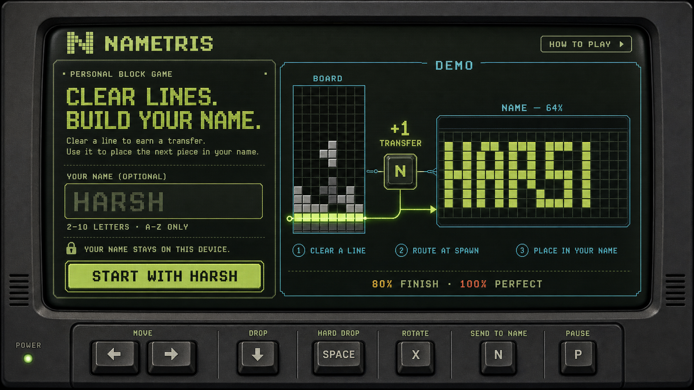
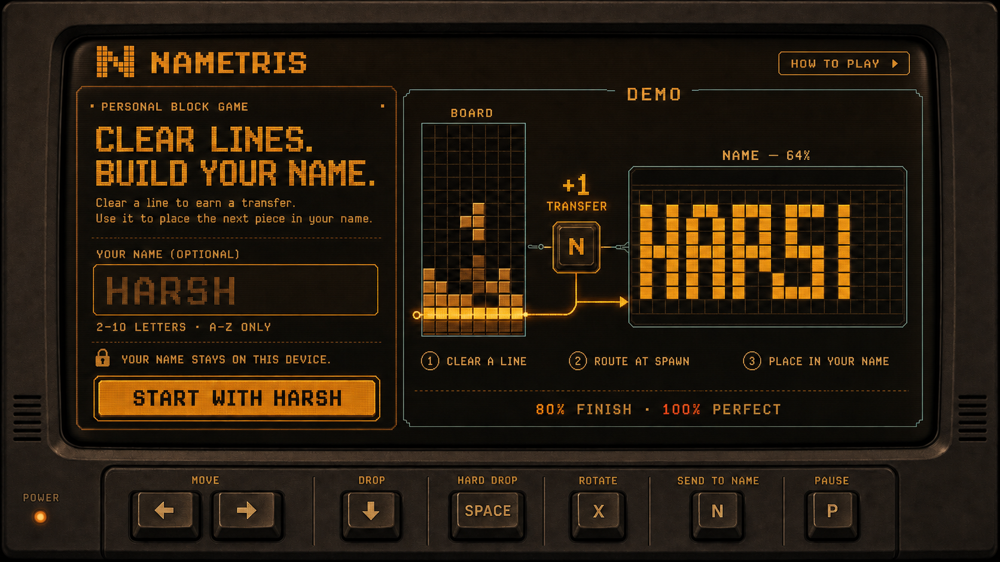
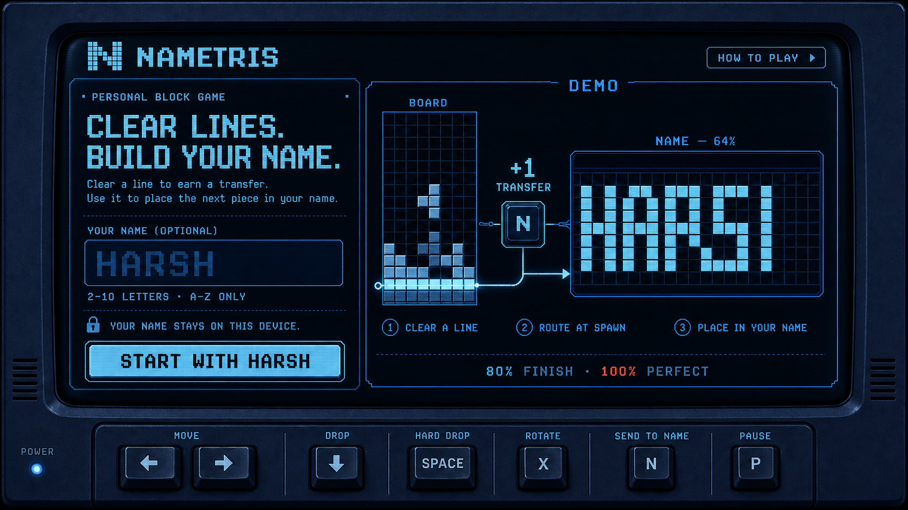
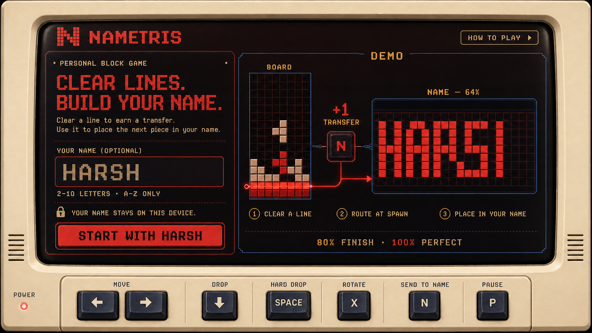

# Nametris Welcome Screen

Status: Proposed

## Visual Concept



### Color Variants

#### Amber Terminal



#### Ice-Blue Arcade



#### Warm Ivory + Signal Red



## Design Direction

Use a **Transfer Rail** composition: a compact onboarding panel on the left and a
non-interactive two-board demonstration on the right. The player's name is the
largest element in the preview.

This screen should answer three questions within a few seconds:

1. What is Nametris?
2. Why does it need my name?
3. How do pieces move from the board into my name?

## Recommended Layout

```text
┌─────────────────────────────────────────────────────────────────────────────┐
│ [block-N] NAMETRIS                                      [HOW TO PLAY] [?]  │
├───────────────────────────┬─────────────────────────────────────────────────┤
│ PERSONAL BLOCK GAME       │ DEMO                                            │
│                           │                                                 │
│ CLEAR LINES.              │  BOARD          +1          NAME — 64%          │
│ BUILD YOUR NAME.          │ ┌────────┐    TRANSFER    ┌──────────────────┐  │
│                           │ │        │ ──── [ N ] ───▶│ H A R S H        │  │
│ Clear a line to earn a    │ │  ████  │               │ ▣ □ ▣ □ ▣ ...    │  │
│ transfer. Use it to place │ └────────┘               └──────────────────┘  │
│ the next piece in your    │   CLEAR          ROUTE          PLACE           │
│ name.                     │   A LINE         AT SPAWN       IN YOUR NAME    │
│                           │                                                 │
│ YOUR NAME (OPTIONAL)      │              80% FINISH · 100% PERFECT          │
│ ┌───────────────────────┐ │                                                 │
│ │ HARSH                 │ │                                                 │
│ └───────────────────────┘ │                                                 │
│ 2–10 letters · A–Z only   │                                                 │
│ Your name stays on this   │                                                 │
│ device.                   │                                                 │
│                           │                                                 │
│ [ START WITH HARSH  → ]   │                                                 │
├───────────────────────────┴─────────────────────────────────────────────────┤
│ MOVE [←][→]  SOFT DROP [↓]  HARD DROP [SPACE]  ROTATE [X][Z]               │
│ SEND TO NAME [N]  PAUSE [P]                                      CONTROLS  │
└─────────────────────────────────────────────────────────────────────────────┘
```

At the minimum 1180 × 720 viewport:

- Header: 64 px
- Main content: approximately 36/64 split
- Controls dock: 72 px
- Keep the form vertically aligned with the transfer rail
- Keep the demonstration visibly labeled `DEMO` so it does not appear playable

## Final Landing Copy

### Brand

- Game name: `NAMETRIS`
- Eyebrow: `PERSONAL BLOCK GAME`
- Headline: `CLEAR LINES. BUILD YOUR NAME.`
- Supporting copy: `Clear a line to earn a transfer. Use it to place the next
  piece in your name.`
- Risk/reward note: `Finish at 80%—or push for perfect.`

### Name Entry

- Label: `YOUR NAME (OPTIONAL)`
- Empty-state default: `HARSH`
- Helper: `2–10 letters · A–Z only`
- Privacy: `Your name stays on this device.`
- Default CTA: `START WITH HARSH`
- Entered-name CTA: `START WITH {NAME}`

Examples:

- `START WITH MAYA`
- `START WITH DEVANSH`

### Demonstration

- Left label: `BOARD`
- Transfer label: `+1 TRANSFER`
- Right label: `NAME — 64%`
- Step one: `CLEAR A LINE`
- Step two: `ROUTE AT SPAWN`
- Step three: `PLACE IN YOUR NAME`
- Completion note: `80% FINISH · 100% PERFECT`

## Name Field Behavior

`HARSH` should behave as a default placeholder, not as a literal value the player
must erase.

- The field is technically empty on load.
- Show `HARSH` in a muted state that still meets text contrast requirements.
- Typing replaces the placeholder immediately.
- Submitting the empty field starts a game with `HARSH`.
- Convert valid input to uppercase as the player types.
- Trim leading and trailing whitespace on submission.
- `Enter` starts when the form is valid.
- Update the name in the demonstration as the player types.
- Do not activate gameplay keyboard shortcuts on this screen.

### Validation Copy

Use specific errors rather than one generic message:

- One letter: `Add 1 more letter.`
- More than ten letters: `Keep it to 10 letters.`
- Unsupported characters: `Use letters A–Z only.`

Keep the error associated with the field, announce it accessibly, and retain focus
in the input after an invalid submission.

## Controls

Show only the controls needed to begin playing in the persistent dock:

- `MOVE` — `←` `→` or `A` `D`
- `SOFT DROP` — `↓` or `S`
- `HARD DROP` — `SPACE`
- `ROTATE` — `X` `Z`
- `SEND TO NAME` — `N`
- `PAUSE` — `P` or `ESC`

Give `SEND TO NAME [N]` the accent color because it is Nametris's unfamiliar
action.

An `ALL CONTROLS` action opens a keyboard-accessible tray with the stencil
controls:

- Move — Arrow keys or `WASD`
- Rotate — `X` or `Z`
- Place — `Enter` or `Space`
- Return to board — `Esc`

## Preview Motion

Use a restrained seven-second loop:

1. A piece completes and clears a row on the normal board.
2. A `+1` transfer chip travels into the center rail.
3. A new piece appears in the spawn zone.
4. The `N` keycap pulses once.
5. The piece moves across the rail and fills four cells in the name.
6. Completion changes from `60%` to `64%`.

Pause the loop while the name input has focus. Under reduced-motion preferences,
show the final static sequence with the three captions and connecting arrow.

## Visual Language

Aim for **screen-print arcade**, not neon cyberpunk:

- Warm bone canvas
- Near-black ink and board fields
- Acid lime for transfers and the primary action
- Cyan, coral, violet, and amber for pieces
- Square corners, 2 px rules, and restrained offset shadows
- Block-built display face for the logo and player name
- Clean grotesk body type and monospaced labels/keycaps
- A faint game grid outside the two boards

The logo mark should depict two small board shapes joined by one transfer square
to create an abstract `N`.

## Alternatives Considered

### Arcade Cabinet

A centered cabinet with the form inside the screen and all controls on a physical
control deck. It is the fastest and most immediately game-like option, but it
does less to distinguish Nametris from a conventional falling-block game.

### Typographic Poster

An editorial full-screen layout where the live player name is the entire hero.
It gives Nametris the strongest visual identity, but teaches the two-board
relationship less effectively.

The recommended Transfer Rail direction combines the instructional strength of
the split-board preview with the personalization and typographic confidence of
the poster.
